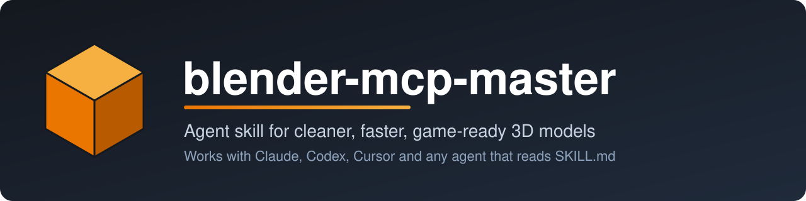
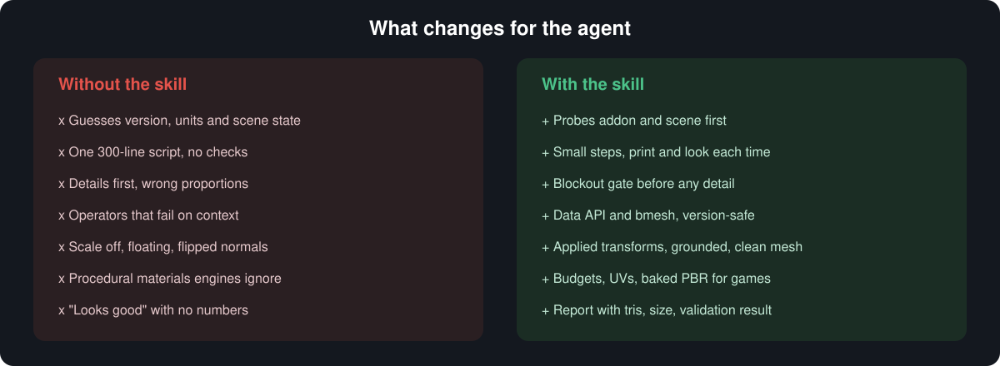
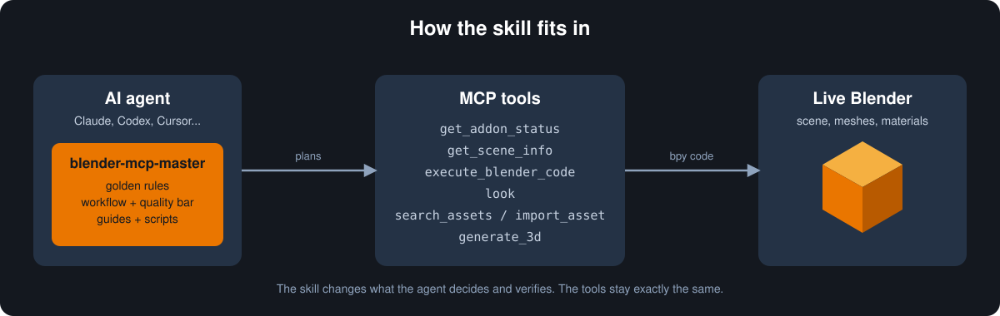
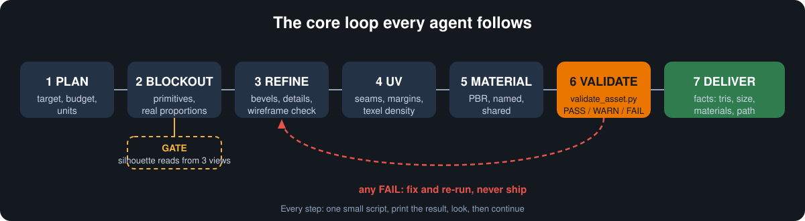

# blender-mcp-master

<p align="center"></p>

**English** | [Português](#português)

An agent skill that helps AI agents create better Blender assets through MCP: cleaner geometry, deliberate scale, better materials, reliable validation, and game-ready exports.

- Works with agents that support the [Agent Skills](https://agentskills.io/) format, including Claude Code, Codex, Cursor, and other compatible clients.
- Uses an inspect → blockout → refine → validate → correct workflow.
- Includes reusable Blender Python scripts and focused reference guides.
- MCP tool names vary by implementation. Discover the tools available in your active Blender MCP server instead of assuming every integration exposes the same tools.

<p align="center"></p>

## How it works

The skill changes what the agent decides and verifies while using Blender-control MCP tools. The npm package also includes a small stdio MCP server that exposes this skill, its reference guides, and script templates. That resource server does not itself control a live Blender scene; pair it with a separate Blender-control MCP server for live operations.

<p align="center"></p>

<p align="center"></p>

## Install

Install the skill with the Skills CLI:

```bash
npx skills add God-601/blender-mcp-master
```

If your client does not support the Skills CLI, clone/download this repository and point the agent to the root `SKILL.md`, or install the repository in that client's skills directory.

### npm / npx MCP resource server

The npm package bundles `SKILL.md`, the `references/` guides, and the `scripts/` templates:

```bash
npx -y blender-mcp-master
```

Add it to an MCP client configuration using command `npx` and args `["-y", "blender-mcp-master"]`. It exposes `get_blender_skill`, `list_blender_resources`, `get_blender_reference`, `get_blender_script`, and `get_blender_mcp_setup` over stdio. The package is a skill/resource server, **not** a replacement for a Blender-control MCP server; configure a separate live Blender integration for scene editing.

Other CLI commands: `npx -y blender-mcp-master skill` prints the skill, and `npx -y blender-mcp-master list` lists bundled guides and scripts.

## Repository layout

- `SKILL.md` — core instructions and workflow.
- `references/` — focused guides for hard-surface, organic, character, environment, materials, lighting, export, performance, troubleshooting, budgets, and the modeling quality loop.
- `scripts/` — utilities for validation, cleanup, origins, bevel/shading, LODs, PBR materials, exports, and scene setup.

## Validation and compatibility

The scripts are designed to be pasted into Blender's Python/MCP execution environment. They use Blender's `bpy` API and cannot be fully tested by ordinary Python alone.

**Testing status:** repository changes must be validated in Blender before being treated as runtime-tested. Static review is not a substitute for running the scripts in the target Blender version. Check the script output and inspect the resulting asset before delivery. No compatibility claim is made for a Blender version unless it has been tested there.

| Blender | Status |
|---|---|
| 5.2.3 | Automated: `tests/test_blender_runtime.py` runs every script through the `bpy` module, locally and in GitHub Actions (job `blender-runtime`). |
| 3.1.2 | An independent agent reported 54/54 tests passing in headless Blender 3.1.2 on the reviewed revision. The latest follow-up changes have not yet been rerun on 3.1.2. |
| 3.2 to 5.1 | Not tested. The scripts contain version checks for known API differences, but they have not been run there. |

Run the tests yourself:

```bash
python -m unittest discover -s tests -v          # static checks only; runtime tests are skipped without bpy
pip install bpy==5.2.3                           # needs the matching Python version (3.13 for this wheel)
python -m unittest discover -s tests -v          # now includes the Blender runtime tests
```

The runtime suite covers GLB export and rollback after a failed LOD run. Rigged meshes/armatures and shape keys are not supported by `export_asset.py` and `make_lods.py`.

## Safety notes

- Review a script's configuration before running it on a production scene.
- Make a backup before running destructive mesh cleanup or export workflows.
- Treat imported files, scene content, and code sent through an MCP server as untrusted.
- Never assume a validation warning is a defect without considering the asset type and target pipeline.

## License

MIT

---

<a id="português"></a>
# Português

Uma skill para ajudar agentes de IA a criar modelos melhores no Blender via MCP: geometria mais limpa, escala consciente, materiais melhores, validação confiável e exportação para jogos.

- Compatível com agentes que suportam o formato [Agent Skills](https://agentskills.io/), incluindo Claude Code, Codex, Cursor e outros clientes compatíveis.
- Usa um fluxo de inspeção → blockout → refinamento → validação → correção.
- Inclui scripts reutilizáveis em Python para Blender e guias de referência.
- Os nomes das ferramentas MCP variam conforme a implementação. Descubra as ferramentas disponíveis no servidor Blender MCP ativo em vez de presumir que todas as integrações oferecem as mesmas funções.

## Instalação

Instale a skill usando o Skills CLI:

```bash
npx skills add God-601/blender-mcp-master
```

Se o seu cliente não oferecer suporte ao Skills CLI, clone/baixe este repositório e indique o arquivo `SKILL.md` na raiz, ou instale o repositório na pasta de skills desse cliente.

### Servidor MCP via npm/npx

O pacote npm inclui `SKILL.md`, os guias de `references/` e os scripts de `scripts/`:

```bash
npx -y blender-mcp-master
```

Na configuração do cliente MCP, use o comando `npx` e os argumentos `["-y", "blender-mcp-master"]`. O servidor stdio disponibiliza `get_blender_skill`, `list_blender_resources`, `get_blender_reference`, `get_blender_script` e `get_blender_mcp_setup`. Ele fornece a skill e os recursos, mas **não controla sozinho uma cena Blender ao vivo**; para editar cenas, configure também um servidor MCP separado que controle o Blender.

Comandos adicionais: `npx -y blender-mcp-master skill` imprime a skill e `npx -y blender-mcp-master list` lista os guias e scripts.

## Estrutura do repositório

- `SKILL.md` — instruções principais e fluxo de trabalho.
- `references/` — guias de hard-surface, orgânicos, personagens, ambientes, materiais, iluminação, exportação, desempenho, solução de problemas, orçamentos e ciclo de qualidade.
- `scripts/` — utilitários de validação, limpeza, origem, bevel/sombreamento, LODs, materiais PBR, exportação e configuração de cena.

## Validação e compatibilidade

Os scripts foram feitos para serem executados no ambiente Python/MCP do Blender. Eles usam a API `bpy` e não podem ser testados completamente com Python comum fora do Blender.

**Status dos testes:** alterações no repositório precisam ser validadas dentro do Blender antes de serem consideradas testadas em execução. Revisão estática não substitui a execução dos scripts na versão-alvo do Blender. Confira a saída dos scripts e inspecione o modelo resultante antes da entrega. Não declare compatibilidade com uma versão do Blender sem testá-la.

| Blender | Status |
|---|---|
| 5.2.3 | Automatizado: `tests/test_blender_runtime.py` roda todos os scripts pelo módulo `bpy`, localmente e no GitHub Actions (job `blender-runtime`). |
| 3.1.2 | Um agente independente informou 54/54 testes aprovados no Blender 3.1.2 headless na revisão analisada. As alterações mais recentes ainda não foram testadas novamente nessa versão. |
| 3.2 a 5.1 | Não testado. Os scripts têm verificações de versão para diferenças conhecidas da API, mas não foram executados nessas versões. |

Para rodar os testes:

```bash
python -m unittest discover -s tests -v          # só verificações estáticas; os testes de runtime são pulados sem bpy
pip install bpy==5.2.3                           # exige a versão correspondente do Python (3.13 neste wheel)
python -m unittest discover -s tests -v          # agora inclui os testes de runtime no Blender
```

A suíte de runtime cobre exportação GLB e rollback após falha na geração de LOD. Malhas com rig/armatures e shape keys não são suportadas por `export_asset.py` e `make_lods.py`.

Os diagramas do fluxo estão na seção em inglês, acima.

## Segurança

- Confira a configuração de cada script antes de executá-lo em uma cena de produção.
- Faça backup antes de usar scripts de limpeza destrutiva de malha ou exportação.
- Trate arquivos importados, conteúdo da cena e código enviado por MCP como dados não confiáveis.
- Não considere todo aviso de validação um defeito sem levar em conta o tipo de asset e o destino.

## Licença

MIT
