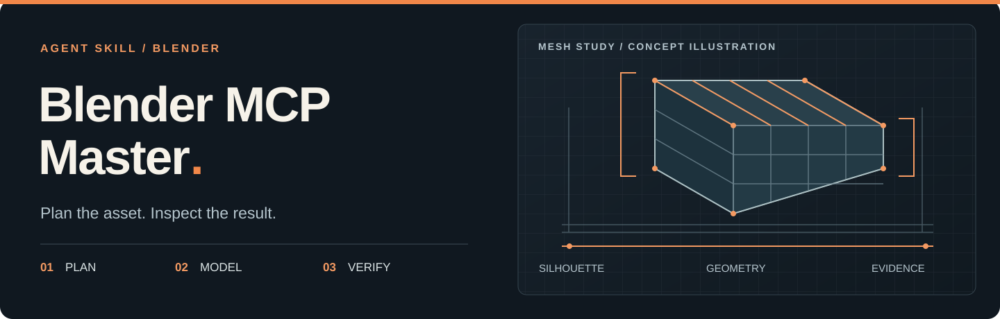
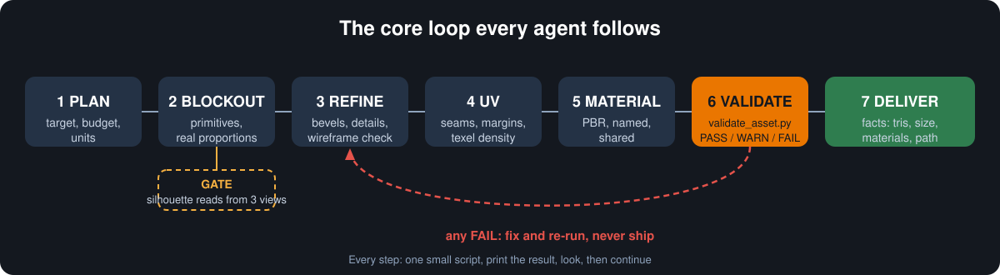
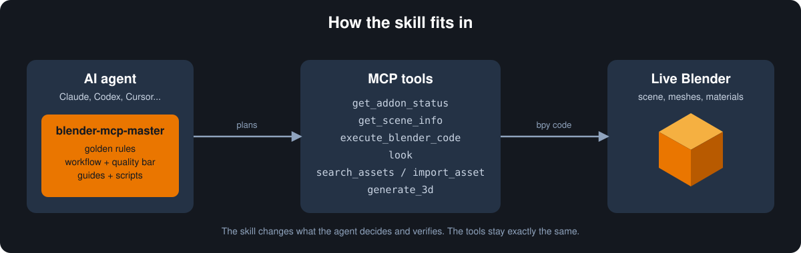

# Blender MCP Master

<p align="center">
  <strong>Model with intent. Verify with evidence.</strong><br>
  An open-source Agent Skill for Blender workflows.
</p>

<p align="center">
  <a href="https://github.com/God-601/blender-mcp-master/releases"></a>
  <a href="LICENSE"></a>
  <a href="https://github.com/God-601/blender-mcp-master/actions/workflows/static-checks.yml"></a>
</p>

<p align="center">
  <a href="#get-started">Get started</a> ·
  <a href="#workflow">Workflow</a> ·
  <a href="#documentation">Documentation</a> ·
  <a href="#portugues">Português</a>
</p>

---

<p align="center"></p>

### Better decisions. Better meshes.

Blender MCP Master helps AI agents **plan, model, inspect, and validate** Blender assets using task-specific instructions, scripts, and evidence-based quality checks.

> **Important:** This skill does **not** control Blender by itself. Live editing needs a separate Blender-control MCP server and Blender addon. The optional MCP resource server here is *read-only*.

| Define | Build | Inspect | Deliver |
| :--- | :--- | :--- | :--- |
| Establish style, purpose, proportions, and constraints. | Block out primary forms, then refine in reversible stages. | Verify actual mesh data and visual references. | Disclose measured results and what remains unverified. |

## Get started

**1. Install the skill using the CLI**

```bash
npx skills add God-601/blender-mcp-master -g
```

**Or download the release ZIP**

**[Download v0.2.0-beta.1 · Installable ZIP](https://github.com/God-601/blender-mcp-master/releases/download/v0.2.0-beta.1/blender-mcp-master-0.2.0-beta.1.zip)**

Get [SHA256SUMS.txt](https://github.com/God-601/blender-mcp-master/releases/download/v0.2.0-beta.1/SHA256SUMS.txt) from the same release, verify the hash, extract the ZIP and copy its inner `blender-mcp-master` folder to your agent's skills directory. Full [Windows and agent setup instructions](docs/QUICKSTART.md).

**2. Set up Blender control separately**

Connect a compatible Blender-control MCP and its addon; discover the actual tool names and Blender version. Start in a scratch or backed-up scene. The skill supplies guidance, **not** a live Blender connection.

<details>
<summary><strong>Optional: read-only MCP resource server</strong></summary>

If published to npm, the package can expose text references and script templates over stdio:

```bash
npx -y blender-mcp-master@0.2.0-beta.1
```

Without an npm publication, the GitHub source can be used instead:

```bash
npx -y github:God-601/blender-mcp-master
```

Neither command provides Blender scene-control tools.
</details>

<p align="center"></p>

**1.0 preparation:** The work from PRs #29–#32 is now integrated into
`main`; #28's UV implementation was incorporated by #32. The latest public
tag remains `v0.2.0-beta.1`. The [1.0 release roadmap](docs/ROADMAP-1.0.md)
defines the remaining isolated clean-install and publication steps.
See the [evidence ledger](docs/RELEASE-1.0-EVIDENCE.md) for known limitations.
A successful package smoke test does **not** verify real Codex/Claude
discovery, Blender-control MCP connectivity, engine imports or visual quality.

## Workflow

```text
USER BRIEF + REFERENCE
          |
          v
  BLENDER MCP MASTER  [Agent Skill]
  Clarify -> Plan -> Blockout -> Refine -> Verify
          |                              ^
          v                              |
  BLENDER-CONTROL MCP ------------------+
          |
       Blender scene
```

The agent must **inspect before it claims success**. Geometry checks, screenshots, and target-format checks answer different questions; missing evidence is **NOT VERIFIED**, not a pass.

| Focus | What changes |
| :--- | :--- |
| **Scene safety** | Explicit targets, owned collections, backup-first changes |
| **Modeling quality** | Proportion checks before unnecessary micro-detail |
| **Technical validity** | Evaluated topology, modifiers, UVs, materials, and budgets |
| **Visual validation** | Real viewport views before judging appearance |
| **Delivery** | `PASS / ISSUE / N/A / NOT VERIFIED` plus known limitations |

Supported workflows include hard-surface props, organic modeling, stylized and low-poly assets, architecture, environments, characters, UV/baking, materials, and game-ready exports. Available features depend on the actual Blender installation and connected MCP tools.

<p align="center"></p>

## Documentation

| Resource | Purpose |
| :--- | :--- |
| [Quickstart](docs/QUICKSTART.md) | Installation, Windows paths, checksums, and MCP setup |
| [SKILL.md](SKILL.md) | Main instruction entrypoint for agents |
| [Official Blender documentation](references/official-blender-documentation.md) | Curated modeling, modifiers, UV, Geometry Nodes, Python API, export references |
| [Evidence-first workflow](references/evidence-first-workflow.md) | Stage gates, independent review, defect diagnosis, and stop conditions |
| [Modeling standards](references/professional-modeling-standards.md) | Production requirements and quality evidence |
| [Production recipes](references/production-recipes.md) | Concrete modeling examples |
| [Skill comparisons](docs/ECOSYSTEM-COMPARISON.md) | Reference patterns, including Superpowers |
| [1.0 release roadmap](docs/ROADMAP-1.0.md) | Verified implementation status and remaining real Blender/agent tests |
| [Agent efficiency](references/token-efficient-agent-execution.md) | Tool-first, bounded reads and progressive context loading |
| [3D model optimization](references/model-performance-strategy.md) | Evaluated triangle, material, texture and Geometry Nodes guidance |
| [Paired token benchmark](docs/EFFICIENCY-BENCHMARK.md) | Reproducible with/without skill comparison protocol |

<details>
<summary><strong>Tests and contribution</strong></summary>

```bash
python -m unittest discover -s tests -v
```

Some tests require a compatible `bpy` runtime. Passing tests is not proof of artistic quality or live MCP and downstream export compatibility.

[Quality checklist](references/quality-checklist.md) · [Changelog](CHANGELOG.md) · [Contributing](CONTRIBUTING.md)
</details>

---

<a id="portugues"></a>
# Português

**Uma skill para agentes de IA modelarem no Blender com método e evidências.** Ela orienta o agente; não instala nem substitui o Blender-control MCP.

- **Instalar:** `npx skills add God-601/blender-mcp-master -g` ou [baixar o ZIP da Release](https://github.com/God-601/blender-mcp-master/releases/download/v0.2.0-beta.1/blender-mcp-master-0.2.0-beta.1.zip).
- **Alternativa sem npm:** `npx -y github:God-601/blender-mcp-master` inicia o servidor de recursos somente leitura.
- **CLI:** `npx skills add God-601/blender-mcp-master -g` instala a skill.
- **Configurar:** conectar separadamente um Blender-control MCP. Veja o [guia para Windows e agentes](docs/QUICKSTART.md).
- **Fluxo:** esclarecer → planejar → modelar → inspecionar → corrigir → relatar o que foi verificado.
- **Aprofundar:** [documentação oficial](references/official-blender-documentation.md) · [verificação e recuperação](references/evidence-first-workflow.md) · [padrões profissionais](references/professional-modeling-standards.md).

**Beta pública.** Nenhum teste automatizado substitui inspeção visual real ou validação no destino.

<p align="center">
  <a href="LICENSE">MIT License</a> ·
  <a href="https://github.com/God-601/blender-mcp-master/issues">Feedback</a> ·
  <a href="https://github.com/God-601/blender-mcp-master/releases">Releases</a>
</p>
